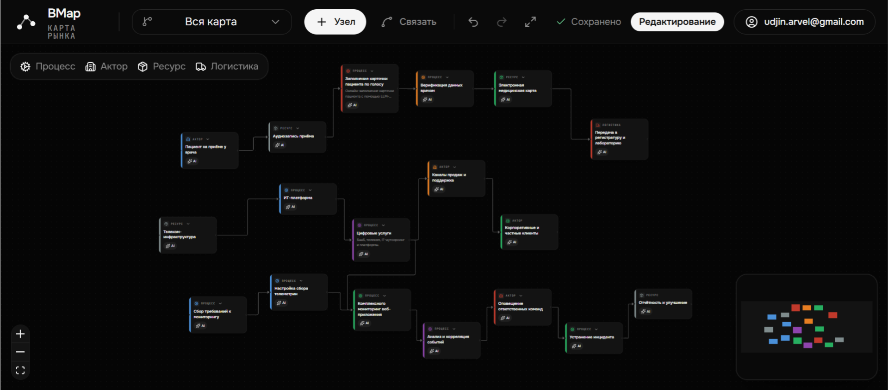
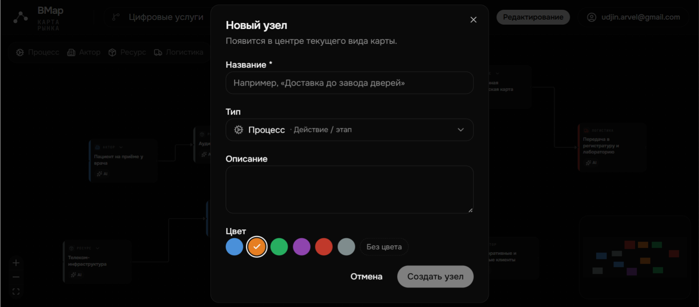
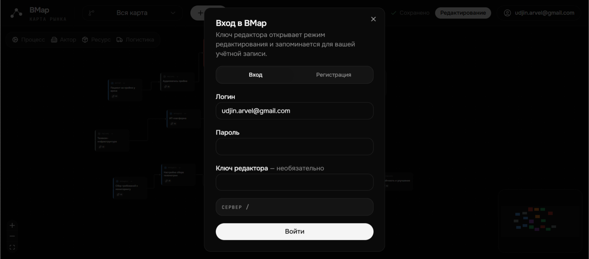

# BMap - карта рынка

Редактор графа, в котором рынок раскладывается на цепочки: процессы, участники, ресурсы и логистика, связанные шагами «что идёт дальше». Можно собирать цепочку руками, а можно выбрать узел и попросить DeepSeek достроить её дальше: модель предложит следующие шаги, сервер разложит их на карте, а другие редакторы увидят изменения сразу, по WebSocket.

Работает вживую: **[bmap.arvelov.space](https://bmap.arvelov.space)**. Смотреть можно после регистрации, редактировать - с ключом редактора.

Часть [портфолио приложений](../README.md).



| Создание узла | Вход и роли |
| --- | --- |
|  |  |

## Задача

Когда разбираешься в незнакомом рынке, в голове быстро получается каша: кто кому что поставляет, где узкое место, через какие этапы проходит продукт. Таблицы и доски с картинками тут плохо помогают, нужна именно цепочка, по которой можно пройти от сырья до клиента. BMap хранит её как граф и даёт достраивать её с помощью модели, не теряя ручной контроль.

## Что внутри

- Граф в Neo4j: узлы `MarketNode` четырёх типов (процесс, актор, ресурс, логистика) и связи `NEXT_STEP`. Можно открыть всю карту или только ветку от выбранного узла - это обход графа в обе стороны одним Cypher-запросом.
- AI-достройка: `POST /api/nodes/{id}/expand` ставит фоновую задачу, DeepSeek генерирует шаги, сервер раскладывает их по координатам и пишет в граф. Статус и патчи графа приходят по WebSocket, для клиентов без него есть опрос задачи.
- Роли: регистрация и вход по JWT, пользователи в SQLite. Читать могут все, менять - только `editor` (ключ редактора запоминается за учётной записью).
- Редактор: перетаскивание, связи, цвета, undo/redo, мини-карта, отложенное автосохранение позиций пакетным запросом.
- 10 базовых областей рынка (лес, строительство, энергетика, логистика и т.д.) создаются при первом старте.
- Без бэкенда клиент работает на моке, AI в этом режиме строит короткую демо-цепочку.
- Тесты: Go (`go test ./...`) на конфиг, модели, роуты, хендлеры и разбор ответа модели; Vitest на правила графа и роутинг клиента.

## Стек

Go (`net/http`, gorilla/websocket, neo4j-go-driver, go-sqlite3, JWT), Neo4j 5, SQLite, DeepSeek API. Клиент: React, TypeScript, TanStack Start, Tailwind CSS. Docker Compose, nginx с HTTPS (Let's Encrypt) на VPS.

## Запуск

Подробно, включая прод: **[DEPLOY.md](DEPLOY.md)**. Все команды: `make help`.

```bash
cp .env.example .env        # JWT_SECRET, NEO4J_PASSWORD, EDITOR_KEY, DEEPSEEK_API_KEY
make up-build               # или docker compose up --build
```

UI: http://127.0.0.1:18480, API через nginx по `/api/*` (напрямую - `:18400`). Вход: `viewer` с паролем из `SEED_VIEWER_PASSWORD` или регистрация; ключ редактора - `EDITOR_KEY`.

Бэкенд без Docker (нужен запущенный Neo4j):

```bash
cd backend
NEO4J_URI=bolt://localhost:7687 NEO4J_PASSWORD=... JWT_SECRET=dev-secret EDITOR_KEY=dev-editor go run .
```

Клиент: `make dev-infra` (Neo4j и API в Docker), затем `cd client && bun run dev` с `VITE_API_URL=/` - Vite проксирует `/api` на `:18400`. Для ручной проверки API есть набор curl-целей: `make -C backend help`.

## API графа (этап 2)

| Метод | Путь | Права | Описание |
|---|---|---|---|
| GET | `/api/graph` | все | Весь граф; `?focusId=` — только ветка узла |
| GET | `/api/graph/roots` | все | Корневые узлы для переключателя веток |
| GET | `/api/nodes/{id}` | все | Полный узел (включая описание) |
| POST | `/api/nodes` | editor | Создать узел |
| PATCH | `/api/nodes/{id}` | editor | Обновить узел (`descriptionPinned` и др.) |
| DELETE | `/api/nodes/{id}` | editor | Удалить узел и связи |
| POST | `/api/nodes/batch-patch` | editor | Пакетное обновление (JSON или `text/plain`, JWT в `?token=`) |
| POST | `/api/edges` | editor | Создать связь |
| DELETE | `/api/edges/{id}` | editor | Удалить связь |

При старте API создаются 10 базовых областей из `backend/seeds/base_markets.json` (встроены в бинарник) (один раз на `seed_id`). В списке графа поле `description` отдаётся только если `descriptionPinned=true`; иначе есть флаг `hasDescription`.

## AI / DeepSeek (этап 4)

В `.env` задайте `DEEPSEEK_API_KEY` (и при необходимости `DEEPSEEK_BASE_URL`, `DEEPSEEK_MODEL`).

| Метод | Путь | Описание |
|---|---|---|
| POST | `/api/nodes/{id}/expand` | `{ "force": false }` → `{ "jobId" }`, фоновая генерация |
| GET | `/api/nodes/{id}/ai-outgoing` | Есть ли уже AI-цепочка |
| GET | `/api/ai/jobs/{jobId}` | Статус и результат (fallback без WebSocket) |
| WS | `/api/ws?token=` | Только `editor`: `ai.status`, `graph.patch` |

В demo-режиме клиента AI строит короткую demo-цепочку без DeepSeek.
