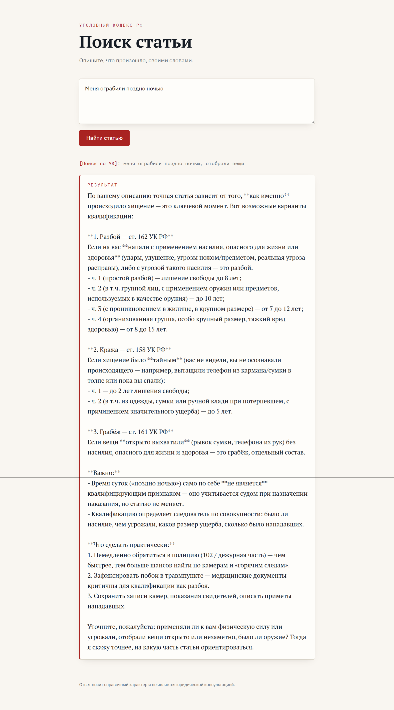
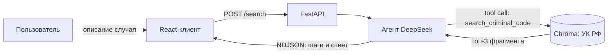

# Поиск по УК РФ: AI-агент

Описываешь ситуацию своими словами («меня ограбили поздно ночью»), агент сам формулирует поисковые запросы, находит подходящие статьи Уголовного кодекса и объясняет квалификацию и возможное наказание. Шаги поиска видны в интерфейсе в реальном времени.



Часть [портфолио приложений](../README.md).

> Это учебный проект, а не юридическая консультация.

## Задача

Человек не знает номера статьи и юридических терминов, он описывает случай бытовым языком. Полнотекстовый поиск тут не помогает: слова «ограбили» в кодексе нет, есть «открытое хищение чужого имущества». Нужен поиск по смыслу и модель, которая сама решает, что и как искать, но отвечает только по найденному тексту кодекса.

## Как работает



1. **Индексация** (`ingest.py`). Кодекс режется по статьям регуляркой; длинные статьи дорезаются `RecursiveCharacterTextSplitter` (1000 символов, перекрытие 200), номер статьи сохраняется в метаданных. Эмбеддинги считаются локально моделью `multilingual-e5-small` и складываются в Chroma с косинусной метрикой.
2. **Tool calling** (`agent.py`). Модель получает инструмент `search_criminal_code` и сама решает, вызывать ли его и с каким запросом. Запросов может быть несколько, если в случае несколько деяний.
3. **RAG.** Результаты поиска возвращаются модели как ответ инструмента; системный промпт запрещает придумывать статьи, которых нет в найденном тексте.
4. **Стриминг** (`main.py`). FastAPI отдаёт события построчно в NDJSON: каждый шаг поиска (`step`), итоговый ответ (`result`) или ошибку (`error`). Клиент показывает шаги по мере поступления.

## Что внутри

```
ingest.py       нарезка кодекса и загрузка векторов в Chroma
embeddings.py   локальные эмбеддинги e5 (префиксы passage/query, нормализация)
agent.py        агент: tool calling + поиск по Chroma
main.py         FastAPI: POST /search (NDJSON-стрим), GET /health
client/         веб-интерфейс на React (TanStack Start)
```

Несколько решений, которые влияют на качество:

- У e5 разные префиксы для документов и запросов (`passage:` / `query:`); без них поиск заметно хуже.
- Векторы нормализуются, иначе косинусная метрика в Chroma даёт неверный порядок.
- Индекс и запрос считаются одной и той же моделью: векторы из разных моделей несравнимы.
- Без `VITE_API_URL` клиент работает в демо-режиме, чтобы интерфейс можно было посмотреть без бэкенда.
- Парсер NDJSON на клиенте покрыт тестами (Vitest).

## Стек

Python, FastAPI, Pydantic, DeepSeek API (OpenAI-совместимый, tool calling), ChromaDB, sentence-transformers (`intfloat/multilingual-e5-small`), LangChain Text Splitters. Клиент: React 19, TypeScript, TanStack Start / Router / Query, Tailwind CSS, shadcn/ui, Vitest.

## Запуск

Бэкенд:

```bash
pip install -r requirements.txt
cp .env.example .env          # DEEPSEEK_API_KEY
python ingest.py              # один раз: строит индекс в ./chroma_db из UKRF.md
uvicorn main:app --reload     # http://localhost:8000
```

Клиент:

```bash
cd client
cp .env.example .env          # VITE_API_URL=http://localhost:8000
npm install
npm run dev
```

Проверка без клиента:

```bash
curl -N -X POST http://localhost:8000/search \
  -H "Content-Type: application/json" \
  -d '{"query": "меня ограбили поздно ночью"}'
```
