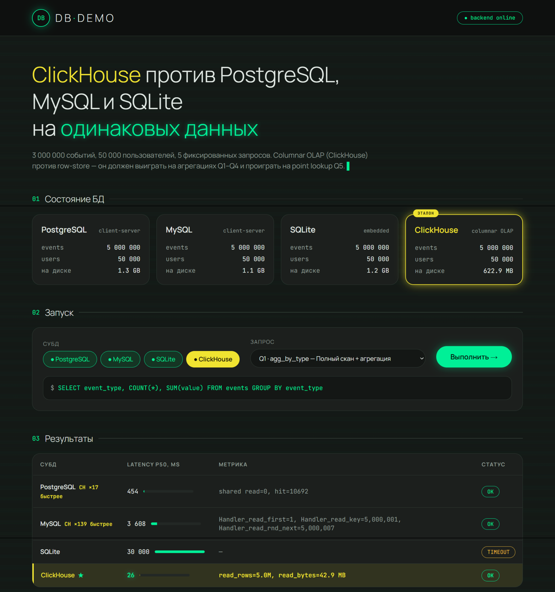
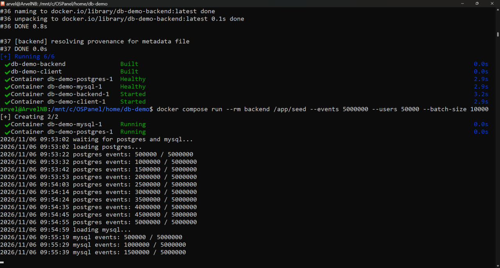
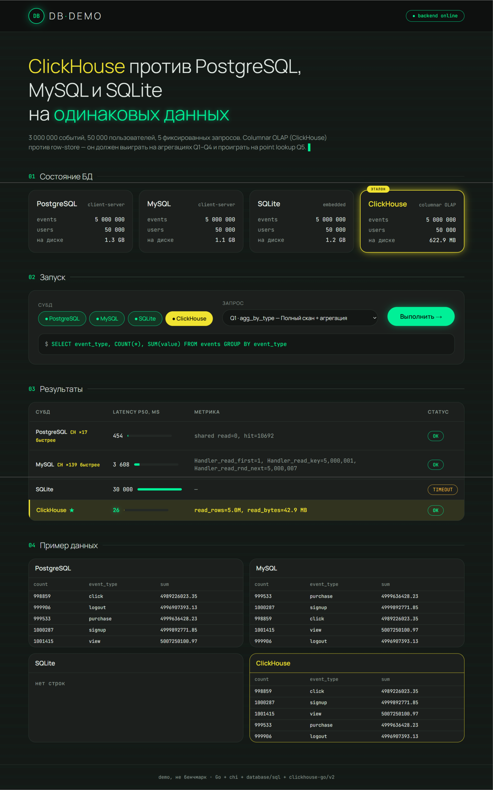
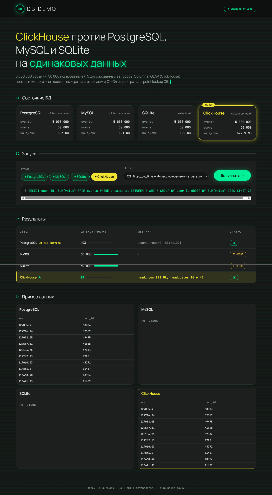
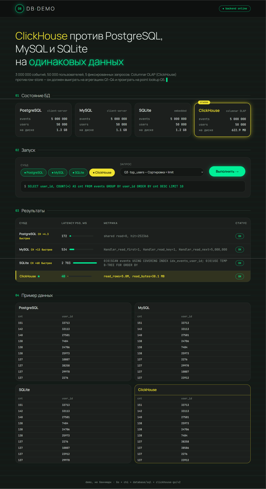
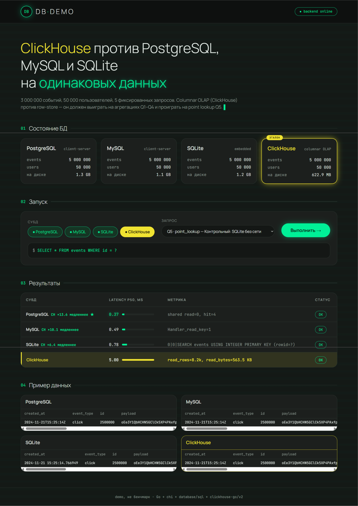

# DB Demo: ClickHouse против PostgreSQL, MySQL и SQLite

Один экран, четыре СУБД, одни и те же данные (**5 000 000 событий, 50 000 пользователей**) и пять фиксированных запросов. Row-store (**PostgreSQL**, **MySQL**, **SQLite**) сравниваются с колоночной OLAP-базой **ClickHouse** по латентности (p50 из трёх прогонов) и по метрике, которой каждая СУБД объясняет свой план.

Часть [портфолио приложений](../README.md).

[](docs/demo-video.mp4)

▶ [Смотреть демо-видео (~3 МБ)](docs/demo-video.mp4) — клик по кадру тоже открывает ролик.

## Главное в цифрах

| | |
| --- | --- |
| **26 мс** против 454 мс у PostgreSQL и 3,7 с у MySQL | агрегация по 5 млн строк (Q1) |
| **в 2 раза меньше места** | 623 МБ у ClickHouse против 1,1–1,3 ГБ у row-store |
| **0,37 мс** у PostgreSQL против 5 мс у ClickHouse | точечный поиск по `id` (Q5): здесь колоночное хранение проигрывает |

## Что показывает проект

| Навык | Как реализовано |
| --- | --- |
| **Go** | Бэкенд на chi: единый интерфейс раннера над четырьмя драйверами (`pgx`, `go-sql-driver/mysql`, `modernc.org/sqlite`, `clickhouse-go/v2`), таймауты через `context`, пулы соединений |
| **Загрузка данных** | CLI `cmd/seed`: генерация 5 млн событий и пакетная вставка батчами по 10 000 во все четыре базы, прогресс в логе |
| **Понимание СУБД** | Схемы под каждую модель хранения: B-tree и индексы у row-store, MergeTree с `ORDER BY (event_type, created_at)` у ClickHouse |
| **Разбор планов запросов** | Метрика из «родного» инструмента каждой СУБД: `EXPLAIN (ANALYZE, BUFFERS)` у PostgreSQL, `Handler_read_%` у MySQL, `EXPLAIN QUERY PLAN` у SQLite, `read_rows` / `read_bytes` из `system.query_log` у ClickHouse |
| **Методология** | Одинаковые данные, p50 из трёх прогонов, жёсткий таймаут 30 с, честный раздел «Ограничения» и объяснение, почему каждый результат именно такой |
| **Инфраструктура** | Весь стенд — PostgreSQL, MySQL, ClickHouse, бэкенд и фронтенд — поднимается одной командой `docker compose up` |
| **Frontend** | React, TanStack Start, своя тёмная тема: карточки состояния БД, запуск запросов, сравнение результатов |

## Быстрый старт

Нужен Docker Desktop. Для ClickHouse в WSL2 выделите **не меньше ~4 GB RAM**.

```bash
docker compose up -d --build
docker compose run --rm backend /app/seed --events 5000000 --users 50000 --batch-size 10000
```

UI: [http://localhost:3000](http://localhost:3000). API: [http://localhost:8080](http://localhost:8080).

Цифры и скрины ниже сняты именно с этого объёма: **5 000 000** событий и **50 000** пользователей. Если памяти мало, тот же сценарий запускается с `--events 3000000`.

С хоста, когда контейнеры БД уже живы:

```bash
# Windows PowerShell
./demo.ps1 seed --events 5000000 --users 50000 --batch-size 10000

# Unix
chmod +x demo.sh && ./demo.sh seed --events 5000000 --users 50000 --batch-size 10000
```

Бэкенд читает `PG_DSN`, `MYSQL_DSN`, `SQLITE_PATH`, `CLICKHOUSE_DSN` (см. [`docker-compose.yml`](docker-compose.yml)). Файл SQLite создаётся на хосте в `data/sqlite.db` (в Git не хранится: после seed это ~1,3 ГБ). В compose у ClickHouse включён `CLICKHOUSE_SKIP_USER_SETUP`, пользователь **`default`** без пароля, DSN: `clickhouse://default@clickhouse:9000/demo`.

Без Docker — те же учётные данные, что в compose, затем:

```bash
cd backend
go run ./cmd/seed --events 5000000 --users 50000 --batch-size 10000
go run ./cmd/server
```

```bash
cd frontend
set VITE_API_URL=http://localhost:8080
npm run dev
```

Если `5432`, `3306`, `8123` или `9000` заняты, поменяйте проброс в `docker-compose.yml` и те же DSN передайте в `go run ./cmd/seed`.

## Что на экране

Заливка батчами по 10 000. Прогресс в логе — каждые 500 000 строк.



После seed все четыре карточки показывают одинаковые `events` / `users`. ClickHouse занимает на диске примерно вдвое меньше: **622.9 МБ** против **1.1–1.3 ГБ** у row-store.

| Запрос | Что делает | Кадр |
|--------|------------|------|
| Q1 `agg_by_type` | `COUNT` + `SUM` по `event_type` | [ниже](#q1--агрегация-по-типу) |
| Q2 `filter_by_time` | сумма `value` за интервал, топ-20 пользователей | [ниже](#q2--фильтр-по-времени) |
| Q3 `top_users` | топ-10 `user_id` по числу событий | [ниже](#q3--топ-пользователей) |
| Q4 `join_regions` | сумма `value` по региону для `segment = premium` | [ниже](#q4--join-с-users) |
| Q5 `point_lookup` | одна строка по `id` | [ниже](#q5--точечный-поиск) |

Таймаут запроса — **30 с**. В таблице это `TIMEOUT`: строки результата нет, латентность не считается.

### Q1 — агрегация по типу

ClickHouse **26 мс** и `read_bytes=42.9 MB` на все 5 млн строк. PostgreSQL 454 мс (буферный кэш, `shared hit=10692`), MySQL 3.7 с, SQLite упирается в таймаут.



### Q2 — фильтр по времени

`ORDER BY (event_type, created_at)` у MergeTree режет диапазон: **29 мс**, `read_rows=892.8k`, `read_bytes=16.6 MB`. PostgreSQL 483 мс из кэша. MySQL и SQLite — timeout.



### Q3 — топ пользователей

Все четыре отвечают. ClickHouse **40 мс** (`read_bytes=38.1 MB`), PostgreSQL 172 мс, MySQL 534 мс, SQLite 2.8 с (covering index, полный обход).



### Q4 — JOIN с users

ClickHouse **47 мс**, хеш по правой таблице `users`, `read_bytes=76.8 MB`. PostgreSQL 405 мс (`shared hit=14` — план почти не трогает heap). MySQL и SQLite — timeout.


### Q5 — точечный поиск

Здесь колоночное хранение проигрывает. PostgreSQL **0.37 мс** (`shared hit=4`), MySQL 0.49 мс (`Handler_read_key=1`), SQLite 0.78 мс (`SEARCH ... INTEGER PRIMARY KEY`). ClickHouse **5.00 мс**: `id` не входит в ключ сортировки, читается гранула — `read_rows=8.2k`, `read_bytes=563.5 KB`.



## Результаты

p50, миллисекунды. Прогон со скринов: 5M `events`, 50k `users`, Docker. `TIMEOUT` — обрыв на 30 с.

| Запрос | PostgreSQL | MySQL | SQLite | **ClickHouse** |
|--------|-----------:|------:|-------:|---------------:|
| Q1 `agg_by_type` | 454 | 3 698 | TIMEOUT | **26** |
| Q2 `filter_by_time` | 483 | TIMEOUT | TIMEOUT | **29** |
| Q3 `top_users` | 172 | 534 | 2 783 | **40** |
| Q4 `join_regions` | 405 | TIMEOUT | TIMEOUT | **47** |
| Q5 `point_lookup` | **0.37** | 0.49 | 0.78 | 5.00 |

Железо в кадр не попало — подставьте своё CPU / RAM / ОС, если повторяете таблицу.

## Почему так выходит

- **Q1–Q4.** ClickHouse читает колонки, которые есть в запросе, а не всю строку с `payload`. Это видно в `read_bytes` из `system.query_log`: на Q1 это 42.9 МБ при 5 млн строк. MergeTree с `ORDER BY (event_type, created_at)` дополнительно сужает Q2 по времени.
- **Q5.** У PostgreSQL, MySQL и SQLite есть B-tree по первичному ключу. У ClickHouse `id` не в ключе сортировки, поэтому point lookup — это чтение гранул, а не один ключ. На этом запросе он в 7–15 раз медленнее соседей.
- **SQLite на Q5.** Движок в том же процессе, без сетевого round-trip. На широких сканах (Q1, Q2, Q4) тот же встроенный движок не успевает за 30 с.
- **Q4.** PostgreSQL строит лёгкий план (`shared hit=14`, 405 мс). MySQL на этом JOIN не укладывается в таймаут — стратегии соединения здесь расходятся сильно.
- **Размер на диске.** 622.9 МБ у ClickHouse против 1.1–1.3 ГБ у row-store на тех же 5 млн строк: колонки сжимаются, `payload` не раздувает каждую запись одинаково.

Метрики нарочно разные. PostgreSQL отдаёт `EXPLAIN (ANALYZE, BUFFERS)`, MySQL — дельту `Handler_read_%`, SQLite — текст `EXPLAIN QUERY PLAN`, ClickHouse — `read_rows` и `read_bytes`. Это не один счётчик в четырёх обёртках, а то, чем каждая СУБД реально объясняет запрос.

## Ограничения

Это демонстрация архитектур, не промышленный бенчмарк: три прогона, один ноутбук, тёплый кэш, без кластера ClickHouse. `TIMEOUT` означает «не уложился в 30 с», а не измеренную скорость. ClickHouse здесь не замена OLTP, SQLite в embedded-режиме не соперник серверным СУБД на полном скане.

## Структура

- [`backend/`](backend/) — Go + chi, `GET /api/status`, `GET /api/queries`, `POST /api/run`, CLI `cmd/seed`, batch insert через `clickhouse-go`
- [`frontend/`](frontend/) — React + Vite + TanStack Start
- [`docker-compose.yml`](docker-compose.yml) — Postgres, MySQL, ClickHouse, backend, frontend
- [`docs/`](docs/) — скрины и [`demo-video.mp4`](docs/demo-video.mp4)
