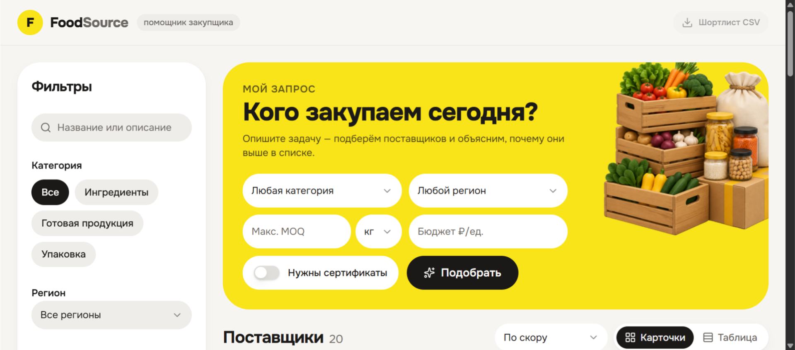
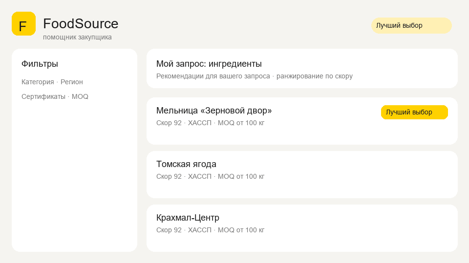
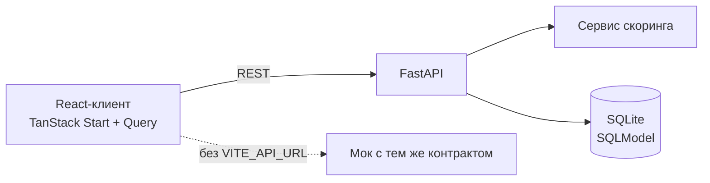

# FoodSource — помощник закупщика

B2B-инструмент для закупщика продуктов: описываешь, что нужно (категория, регион, объём, бюджет, сертификаты), сервис подбирает поставщиков, ранжирует их прозрачным скорингом и объясняет, почему кто-то выше в списке. Можно сравнить 2–3 поставщика, оставить заметки и выгрузить шортлист в CSV.

Часть [портфолио приложений](../README.md).



<details>
<summary><b>Демо: подбор, сравнение и шортлист</b> (GIF, нажмите, чтобы раскрыть)</summary>
<br>

</details>

## Задача

Закупщик выбирает поставщика по десятку параметров сразу: категория, регион, минимальная партия (MOQ), цена за единицу, сертификаты, актуальность данных. В обычном каталоге это ручная работа с таблицей. Здесь запрос задаётся один раз, а сервис сам считает соответствие и показывает причины: «совпадает регион», «MOQ ниже вашего запроса», «данные устарели». Решение остаётся за человеком, но видно, на чём оно основано.

## Что внутри

- Запрос закупщика (query brief) и фильтры: категория, регион, MOQ с единицами, бюджет, сертификаты, поиск.
- Скоринг 0–100 с разбором по критериям и человекочитаемыми причинами; бейджи «Лучший выбор» и топ-3.
- Сравнение 2–3 поставщиков бок о бок; MOQ и цена сравниваются только в одинаковых единицах.
- Подбор `POST /recommend`: топ-3 под запрос с объяснением и весами.
- Карточки и таблица, статусы и заметки по поставщику, экспорт шортлиста в CSV вместе с заметками.
- Пустые и устаревшие данные помечаются явно, а не прячутся.
- Без `VITE_API_URL` клиент работает на встроенном моке с тем же контрактом, что у API.

## Скоринг (0–100)

Баллы начисляются по активным критериям запроса и нормируются на их сумму:

| Критерий | Вес |
|----------|-----|
| Категория совпадает | +30 |
| Регион совпадает | +20 |
| Есть сертификаты (если запрошены) | +20 |
| MOQ ≤ вашего лимита | +15 |
| Цена ≤ бюджета за единицу | +10 |
| Заполненность контактов (тел./email/сайт) | до +10 |
| Данные моложе 180 дней | +5 |

**Reasons** — человекочитаемые строки из сработавших критериев (например «Совпадает регион», «MOQ ниже вашего запроса»). Без запроса оценивается полнота карточки (сертификаты, MOQ, цена, контакты, свежесть).

Бейдж **«Лучший выбор»** — топ-1 по скору при активном query brief; в общем списке подсвечиваются топ-3.

## Архитектура



Вся бизнес-логика (фильтрация, скоринг, бейджи, сравнение, рекомендации) живёт на бэкенде, клиент только отображает ответы: формулу можно менять без релиза фронта. Почему сделано именно так — в [журнале решений](.project/DECISION.md).

## API

- `GET /suppliers` — фильтры и параметры запроса `brief_*` для скоринга
- `GET /suppliers/{id}` — карточка с разбором скоринга
- `POST /compare` — `{ ids: [2..3], brief? }`
- `POST /recommend` — запрос → топ-3 с объяснением
- `GET /meta` — справочники для фильтров

Swagger: http://localhost:8000/docs. Контракт клиента — [`client/src/lib/api/client.ts`](client/src/lib/api/client.ts).

## Тесты

- Бэкенд (pytest): скоринг, список с фильтрами, сравнение, идемпотентный сид — 17 тестов.
- Клиент (Vitest): скоринг мока и роутинг.
- Ручная проверка за 5 минут: [smoke-test](.project/smoke-test.md).

## Стек

Python, FastAPI, SQLModel, SQLite, Pydantic, pytest. Клиент: React 19, TypeScript, TanStack Start / Router / Query, Tailwind CSS, shadcn/ui, Vitest. Docker Compose, Makefile.

## Запуск

```bash
docker compose up --build    # или make up; список команд — make help
```

| Сервис | URL |
| --- | --- |
| UI | http://localhost:8080 |
| API | http://localhost:8000 |
| Swagger | http://localhost:8000/docs |

Без Docker:

```bash
# API
cd backend && pip install -r requirements.txt
uvicorn app.main:app --reload --port 8000

# UI (другой терминал)
cd client && npm install
VITE_API_URL=http://localhost:8000 npm run dev
```

Продакшен-сборка и nginx: [DEPLOY.md](.project/DEPLOY.md).

## Ограничения прототипа

- Данные — ручной сид из ~20 вымышленных поставщиков, без парсинга сайтов.
- Нет авторизации; заметки и статусы хранятся только в браузере.
- Дальше: актуализация источников, рейтинги и отзывы, интеграция с CRM, общие заметки, настройка весов скоринга в UI.
