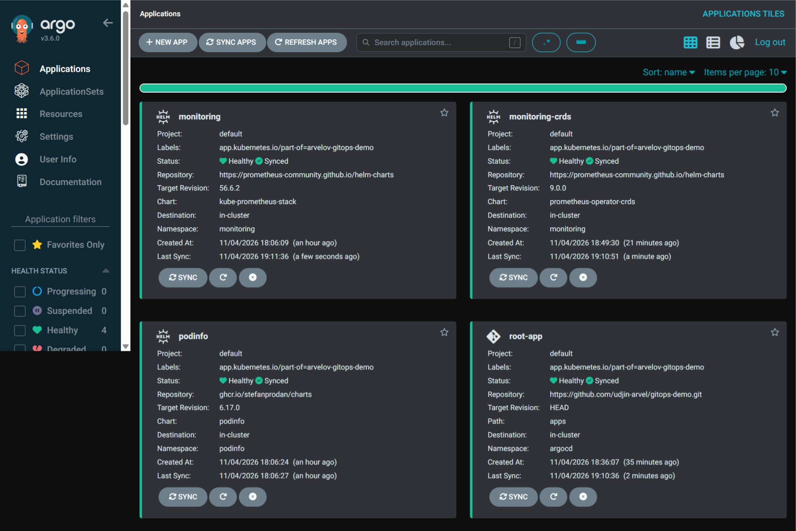
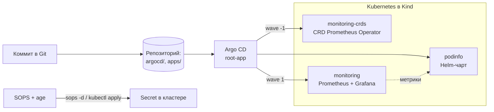
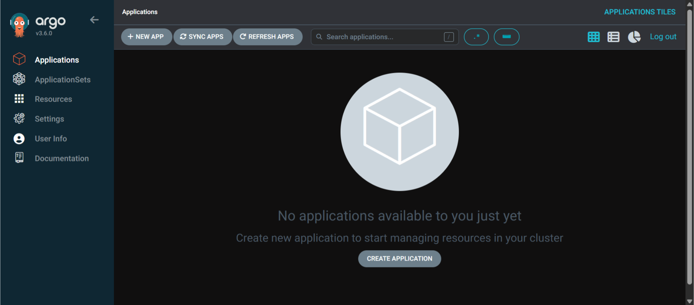
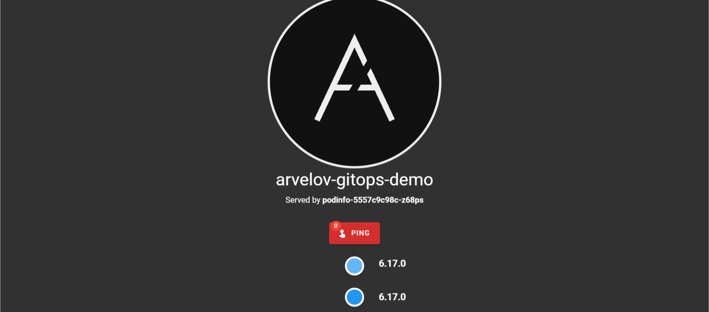
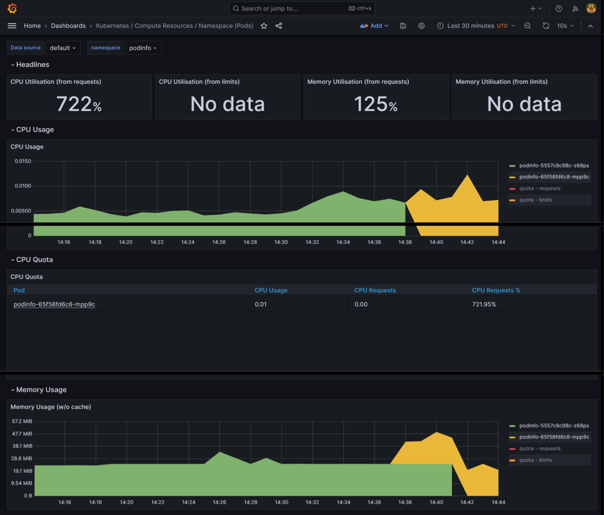
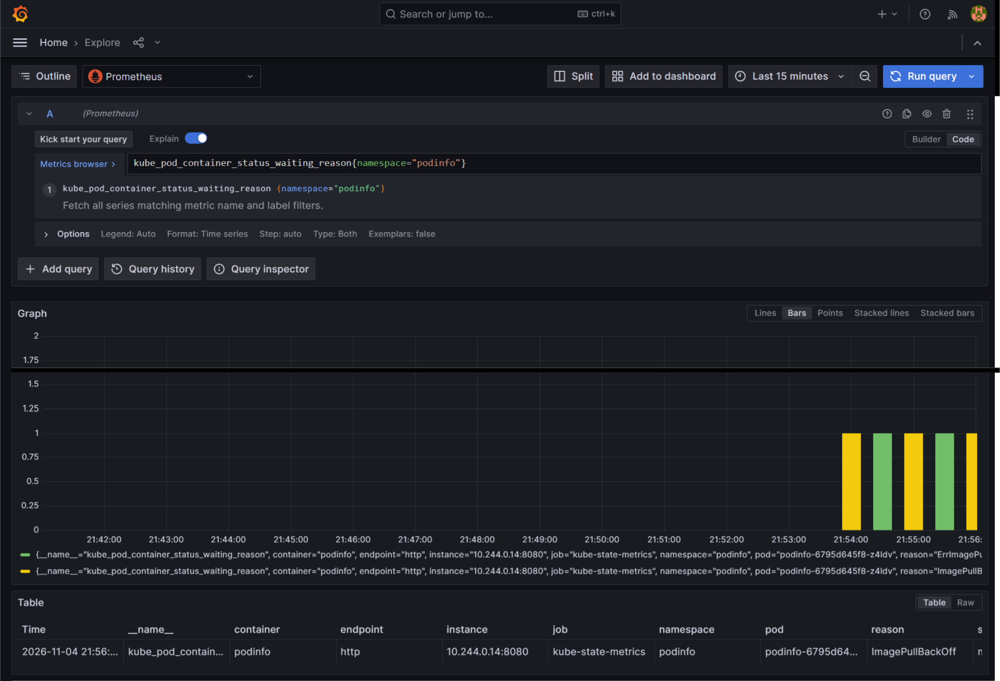
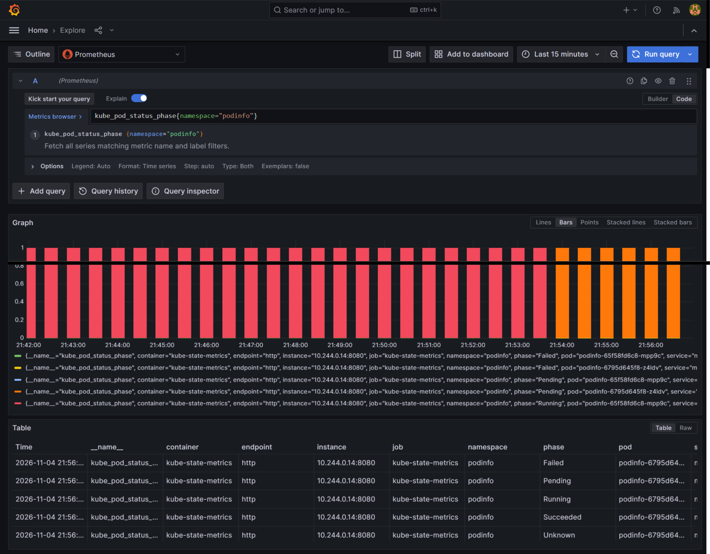

# GitOps-стенд на Kubernetes

Локальный кластер, который целиком описан в Git и разворачивается сам: **Kind** + **Argo CD** (App of Apps) + **Helm** + **kube-prometheus-stack** + **SOPS**. Любое изменение — это коммит; Argo CD приводит кластер к состоянию из репозитория, Prometheus и Grafana показывают, что произошло.

Часть [портфолио приложений](../README.md).

<a href="screens/screenshot2.png"></a>

## Что показывает проект

| Навык | Как реализовано |
| --- | --- |
| **Kubernetes** | Кластер в Kind, проброс NodePort на хост, отдельные namespace под приложение и мониторинг |
| **GitOps (Argo CD)** | Паттерн App of Apps: одно корневое Application подхватывает каталог `apps/` и создаёт дочерние. Автосинхронизация с `prune` и `selfHeal`: ручные правки в кластере откатываются к Git |
| **Helm** | Чарты podinfo и kube-prometheus-stack с версиями, зафиксированными в Git; значения (`valuesObject`) задаются прямо в Application и доезжают до пода |
| **Порядок развёртывания** | Sync waves: CRD Prometheus Operator ставятся отдельным приложением (волна `-1`), стек мониторинга после них (волна `1`). Для больших CRD — `ServerSideApply`, для webhook-конфигураций — `ignoreDifferences` по `caBundle` |
| **Observability** | Prometheus + Grafana: CPU, память и сеть пода, история статусов подов в Explore |
| **Разбор инцидентов** | Сломанный деплой (несуществующий тег образа) виден в Grafana как `ImagePullBackOff`; исправление коммитом возвращает под в `Running` |
| **Секреты** | SOPS + age: в Git только зашифрованный `demo-secret.enc.yaml`, приватный ключ и plaintext закрыты `.gitignore` |
| **Документация** | Пошаговый запуск и [troubleshooting](docs/troubleshooting.md) по типичным сбоям Kind, Argo CD и мониторинга |

## Как устроено



## Стенд в работе

<table>
  <tr>
    <td align="center" width="33%">
      <a href="screens/screenshot1.png"></a>
      <br />
      <b>Kind + Argo CD</b><br />
      UI после установки, кластер готов принимать Application
    </td>
    <td align="center" width="33%">
      <a href="screens/screenshot2.png"></a>
      <br />
      <b>App of Apps</b><br />
      <code>root-app</code>, <code>podinfo</code>, CRD и стек мониторинга — Synced / Healthy
    </td>
    <td align="center" width="33%">
      <a href="screens/screenshot3.png"></a>
      <br />
      <b>Helm values → runtime</b><br />
      Сообщение, цвет и логотип podinfo заданы в Git и доехали до пода
    </td>
  </tr>
  <tr>
    <td align="center" width="33%">
      <a href="screens/screenshot4.png"></a>
      <br />
      <b>Observability</b><br />
      Grafana: CPU, память, сеть пода <code>podinfo</code> из kube-prometheus-stack (клик — дашборд целиком)
    </td>
    <td align="center" width="33%">
      <a href="screens/screenshot5.png"></a>
      <br />
      <b>Диагностика</b><br />
      Explore: <code>ImagePullBackOff</code> после несуществующего тега образа
    </td>
    <td align="center" width="33%">
      <a href="screens/screenshot6.png"></a>
      <br />
      <b>Восстановление</b><br />
      После фикса манифеста под в <code>Running</code>, история Failed / Pending остаётся в Prometheus
    </td>
  </tr>
</table>

## Сценарий: сбой и восстановление через Git

1. В `apps/podinfo/application.yaml` указывается несуществующий тег образа (строка закомментирована в манифесте).
2. Коммит → Argo CD синхронизирует приложение → новый под падает в `ImagePullBackOff`, старая реплика продолжает работать.
3. В Grafana Explore видно, когда и какой под ушёл в ошибку.
4. Исправление — тоже коммит (или `git revert`): Argo CD откатывает деплой, под возвращается в `Running`. Руками в кластере ничего не правится, история инцидента остаётся в Prometheus.

Там же в манифесте есть переключатель fault injection podinfo (`faults.error`) для тренировки на ошибках HTTP 500.

## Стек

Kubernetes (Kind), Argo CD 3.x, Helm, kube-prometheus-stack (Prometheus, Grafana), Prometheus Operator CRDs, podinfo, SOPS, age, Docker, WSL2.

## Структура

```
.
├── kind-config.yaml              # кластер Kind и проброс портов
├── argocd/
│   └── root-app.yaml             # корневое Application (App of Apps)
├── apps/
│   ├── podinfo/
│   │   └── application.yaml      # Helm-чарт podinfo + values
│   └── monitoring/
│       ├── crds-application.yaml # CRD Prometheus Operator, wave -1
│       └── application.yaml      # kube-prometheus-stack, wave 1
├── secrets/
│   ├── demo-secret.yaml          # plaintext, только локально (.gitignore)
│   └── demo-secret.enc.yaml      # зашифрован SOPS, лежит в Git
├── .sops.yaml                    # правила шифрования и публичный ключ age
├── screens/
└── docs/
    └── troubleshooting.md
```

## Требования

Docker, kind, kubectl, helm, sops, age. Удобно запускать из WSL2. Argo CD читает манифесты из Git: `root-app` смотрит в репозиторий [udjin-arvel/gitops-demo](https://github.com/udjin-arvel/gitops-demo), здесь лежит его копия для портфолио.

## 1. Кластер Kind

```bash
kind create cluster --name arvelov-gitops-demo --config kind-config.yaml
kubectl cluster-info --context kind-arvelov-gitops-demo
```

В `kind-config.yaml` проброшен один порт: хост `8080` → NodePort `30080`. На нём слушает `podinfo`.

## 2. Argo CD

```bash
kubectl create namespace argocd
kubectl apply -n argocd -f https://raw.githubusercontent.com/argoproj/argo-cd/stable/manifests/install.yaml
kubectl -n argocd rollout status deploy/argocd-server
```

Начальный пароль admin:

```bash
kubectl -n argocd get secret argocd-initial-admin-secret -o jsonpath="{.data.password}" | base64 -d
```

UI только через port-forward. Порт `8080` на хосте уже занят `podinfo`:

```bash
kubectl -n argocd port-forward svc/argocd-server 8443:443
```

Открыть https://localhost:8443 (логин `admin`). В списке Applications будет `root-app` и дочерние приложения.

## 3. SOPS

Приватный ключ age лежит в `.age/age.key` (каталог в `.gitignore`). Публичный ключ прописан в `.sops.yaml`.

```bash
export SOPS_AGE_KEY_FILE="$PWD/.age/age.key"
```

Перешифровать секрет после правок plaintext:

```bash
sops -e secrets/demo-secret.yaml > secrets/demo-secret.enc.yaml
```

В Git уходит только `.enc.yaml`.

`secrets/demo-secret.yaml` остаётся только локально, он уже в `.gitignore`.

Расшифровка для проверки:

```bash
sops -d secrets/demo-secret.enc.yaml
```

Расшифрованный секрет в кластер (Argo CD сам SOPS не расшифровывает):

```bash
sops -d secrets/demo-secret.enc.yaml | kubectl apply -f -
```

## 4. App of Apps

1. Запушьте репозиторий.
2. В `argocd/root-app.yaml` укажите свой `repoURL`, если он отличается.
3. Зарегистрируйте репозиторий в Argo CD (UI → Settings → Repositories или `argocd repo add`). Helm-репозитории podinfo и Prometheus отдельно регистрировать не нужно: URL чартов уже в Application.
4. Примените корневое приложение:

```bash
kubectl apply -f argocd/root-app.yaml
```

`root-app` создаст `podinfo`, `monitoring-crds` и `monitoring`. При `automated` они синхронизируются сами. Сначала должны встать CRD (`monitoring-crds`), затем стек.

Проверка:

```bash
kubectl -n argocd get applications
kubectl -n podinfo get pods,svc
kubectl -n monitoring get pods,svc
```

## Куда заходить

| Что | Как открыть |
| --- | --- |
| `podinfo` | http://localhost:8080 |
| Argo CD и `root-app` | `kubectl -n argocd port-forward svc/argocd-server 8443:443`, затем https://localhost:8443 |
| Grafana | `kubectl -n monitoring port-forward svc/monitoring-grafana 3000:80`, затем http://localhost:3000 |

`root-app` — это Application в Argo CD, отдельного HTTP-сервиса у него нет. Его статус виден в UI или так:

```bash
kubectl -n argocd get application root-app
kubectl -n argocd describe application root-app
```

Пароль Grafana берётся из секрета чарта (логин по умолчанию `admin`):

```bash
kubectl -n monitoring get secret monitoring-grafana -o jsonpath="{.data.admin-password}" | base64 -d; echo
```

NodePort Grafana — `30081`, но в `kind-config.yaml` он на хост не проброшен, поэтому с Windows на него напрямую не зайти.

## Что не коммитить

- `.age/` и любые приватные ключи age (`*.agekey`)
- `secrets/demo-secret.yaml` (plaintext)

## Дальше

Типичные сбои и как их разбирать: [docs/troubleshooting.md](docs/troubleshooting.md).
