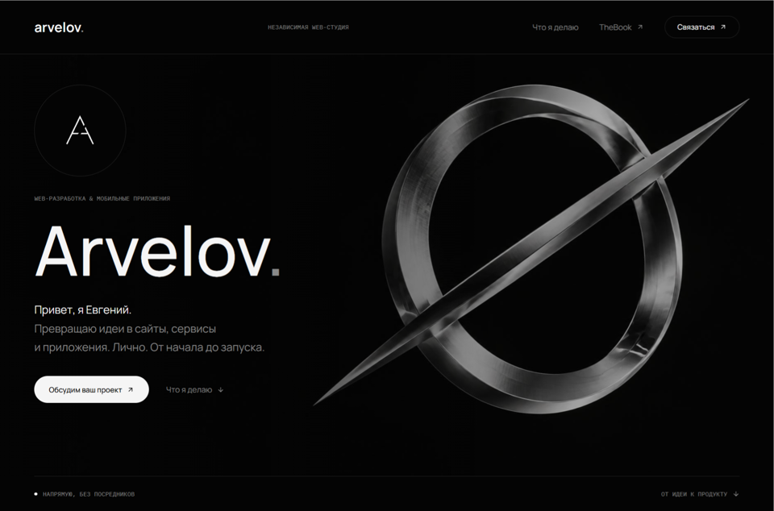
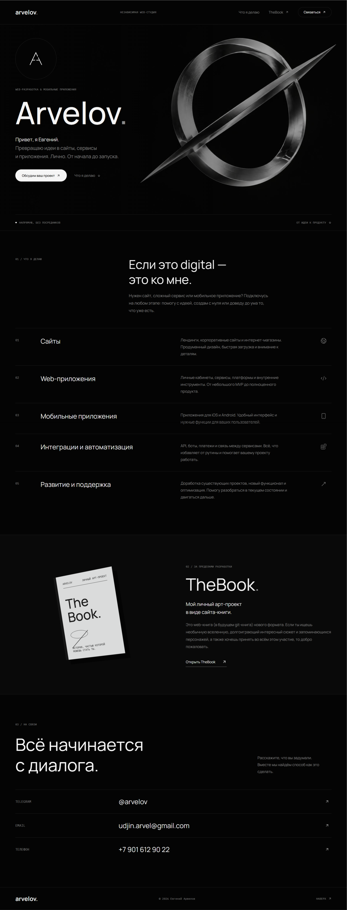

# Arvelov — личный сайт

Сайт-визитка частной веб-студии: кто я, что делаю (сайты, веб-приложения, мобильные приложения, интеграции и поддержка), ссылка на арт-проект TheBook и контакты. Живая версия: [arvelov.online](https://arvelov.online).

Часть [портфолио приложений](../README.md).



<details>
<summary><b>Страница целиком</b> (нажмите, чтобы раскрыть)</summary>
<br>

</details>

## Задача

Короткая страница, после которой понятно, с чем ко мне можно прийти и как связаться. Без каталога и лишней навигации: несколько экранов, тёмная монохромная тема, контакты на виду. Хостинг обычный shared, поэтому на проде только статика.

## Что внутри

```
site/      продакшен-версия: HTML, CSS, JS, .htaccess
src/       прототип на React (TanStack Start), из которого собрана статика
scripts/   build-static.mjs — сборка site/ в dist/
deploy.sh  деплой на хостинге: git pull, сборка, публикация dist/ в корень сайта
```

- Адаптивная вёрстка под десктоп и телефон, SEO-мета и Open Graph.
- `.htaccess`: индексный файл, запрет листинга каталогов, правила переписывания.
- Деплой одной командой на сервере, без CI и без Node.js в рантайме.

## Стек

HTML, CSS, JavaScript; прототип — React, TypeScript, TanStack Start, Tailwind CSS. Деплой — Bash на shared-хостинге (Apache).

## Запуск

```bash
npm install
npm run dev:site    # статическая версия: http://localhost:8080
npm run build       # site/ → dist/
```
