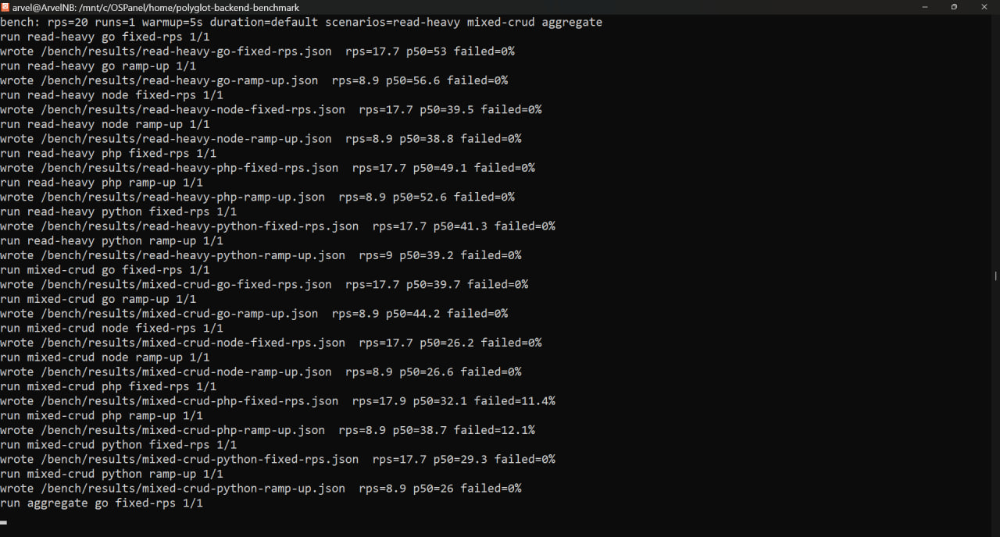

# Polyglot Backend Benchmark: Go, Node.js, PHP, Python

Один и тот же REST API, написанный четыре раза — на **Go**, **Node.js**, **PHP** и **Python** — **без фреймворков**, по одному **OpenAPI**-контракту, поверх одной схемы PostgreSQL и **100 000** одинаковых записей. React-клиент переключает бэкенд на лету, проверяет, что все четыре отвечают одинаково, и показывает результаты нагрузочных прогонов k6.

Часть [портфолио приложений](../README.md).

[](docs/demo-video.mp4)

▶ [Смотреть демо-видео (~5 МБ)](docs/demo-video.mp4) — клик по кадру тоже открывает ролик.

> На скриншоте — живой прогон от 9 ноября 2026: 20 RPS, 1 прогон на комбинацию, ноутбук, Docker Desktop (WSL2). Цифры и выводы — в разделе [Результаты](#результаты).

## Коротко

| | |
| --- | --- |
| **4 реализации, 0 фреймворков** | Go `net/http` + pgx · Node.js `http` + pg · PHP-FPM + PDO за nginx · Python ASGI + uvicorn + asyncpg — сравниваются рантаймы и драйверы, а не обвязка |
| **1 контракт** | [`contract/openapi.yaml`](contract/openapi.yaml) — источник правды; smoke-тесты гоняют один набор проверок по всем четырём бэкендам |
| **Честные условия** | Одинаковые данные и запросы, пул из 20 соединений, лимит **1 CPU / 512 МБ** на каждый бэкенд |
| **Методика** | k6: 3 сценария (read-heavy, mixed-crud, aggregate) × 2 режима (fixed-rps, ramp-up) × 4 бэкенда; нагрузка, длительность, прогрев и число прогонов задаются переменными, при нескольких прогонах берётся медиана |
| **Метрики** | RPS, p50 / p95 / p99, доля ошибок, память в простое и под нагрузкой, CPU, cold start, размер образа, строки кода |

## Что показывает проект

| Навык | Как реализовано |
| --- | --- |
| **Бэкенд на четырёх языках** | Один API (список с фильтрами и пагинацией, CRUD, агрегаты `/stats`, health) идиоматично на Go, Node.js, PHP и Python без фреймворков |
| **Contract-first** | OpenAPI как источник правды, единые коды ошибок, `price` строкой с двумя знаками — чтобы рантаймы не расходились на float; типы для клиента генерируются из контракта |
| **PostgreSQL** | Общая схема и детерминированный сид на 100 000 записей, одинаковые запросы (`SELECT` + `COUNT(*)` с теми же фильтрами) во всех реализациях |
| **Нагрузочное тестирование** | Сценарии k6 с общим модулем настроек, fixed-rps и ramp-up, прогрев, медиана по прогонам, сбор RSS / CPU / cold start скриптами |
| **Docker и инфраструктура** | Compose со всеми сервисами и лимитами ресурсов; прод-конфиг без открытых портов бэкендов и БД, nginx с rate limit и ограничением тела запроса |
| **CI** | GitHub Actions: валидация OpenAPI, golangci-lint, ESLint, ruff, сборка образов, smoke-тесты контракта |
| **Frontend** | React + TanStack Start: переключение бэкенда, CRUD записей, сравнение ответов всех бэкендов в браузере, графики бенчмарков |

## Сверка бэкендов в браузере

Кнопка «Сравнить бэкенды» отправляет один и тот же запрос во все четыре реализации, сверяет ответы с эталоном и показывает медиану времени из трёх прогонов. Это проверка контракта и смоук, а не бенчмарк: в замер входят сеть, nginx и браузер.


## Результаты

Прогон от **9 ноября 2026**: `make bench` с настройками по умолчанию — **20 RPS**, 1 прогон на каждую комбинацию, прогрев 5 с. Ноутбук, Docker Desktop (WSL2), лимит 1 CPU / 512 МБ на бэкенд. Ниже — режим fixed-rps; ramp-up и графики — на странице «Бенчмарки» в UI и в [`client/public/bench/`](client/public/bench/).

**Латентность, мс (fixed-rps, цель 20 RPS)**

| Сценарий | Бэкенд | RPS факт | p50 | p95 | p99 | Ошибки |
| --- | --- | ---: | ---: | ---: | ---: | ---: |
| read-heavy | Go | 17,7 | 53 | 79,5 | 118,7 | 0% |
|  | Node.js | 17,7 | 39,5 | 63,9 | 68,2 | 0% |
|  | PHP | 17,7 | 49,1 | 73,7 | 78,7 | 0% |
|  | Python | 17,7 | 41,3 | 64,7 | 74,3 | 0% |
| mixed-crud | Go | 17,7 | 39,7 | 78,9 | 83,9 | 0% |
|  | Node.js | 17,7 | 26,2 | 67,4 | 72,4 | 0% |
|  | PHP | 17,9 | 32,1 | 73,9 | 81,7 | **11,4%** |
|  | Python | 17,7 | 29,3 | 73,2 | 81,9 | 0% |
| aggregate | Go | 16,8 | 39,5 | 42 | 45,1 | 0% |
|  | Node.js | 16,7 | 31,8 | 33,4 | 36 | 0% |
|  | PHP | 16,7 | 41,6 | 43,7 | 47,4 | 0% |
|  | Python | 16,7 | 32,6 | 33,9 | 38 | 0% |

**Ресурсы и сборка**

| Бэкенд | RSS в простое, МБ | RSS под нагрузкой, МБ | CPU, % | Cold start, мс | Образ, МБ | Строк кода |
| --- | ---: | ---: | ---: | ---: | ---: | ---: |
| Go | 4,9 | 11,6 | 13,5 | 740 | 8,3 | 527 |
| Node.js | 12 | 17,4 | 4,2 | 770 | 77,2 | 323 |
| PHP | 30,7 | 42 | 7,4 | 700 | 60,5 | 320 |
| Python | 20,3 | 21,2 | 4,5 | 3170 | 51,3 | 396 |

**Что видно**

- **На 20 RPS пропускная способность не различается**: все четыре бэкенда держат одинаковую нагрузку, а латентность 25–55 мс задают сеть Docker Desktop и PostgreSQL, а не рантайм. Разница в RPS проявится на нагрузке в разы выше — это следующий прогон.
- **Ресурсы различаются сильно.** Go: образ 8 МБ и 5 МБ памяти в простое. Node.js: самый тяжёлый образ — 77 МБ. PHP-FPM держит больше всех памяти: 31 МБ в простое и 42 МБ под нагрузкой. Python стартует дольше всех — 3,2 с против ~0,7 с у остальных.
- **PHP в mixed-crud — 11–12% ошибок** уже на 20 RPS, у остальных 0%. Это сценарий с записью; вероятные причины — настройки пула FPM или конкурентные записи. Найдено бенчмарком, в работе.

<details>
<summary><b>Лог прогона</b> (нажмите, чтобы раскрыть)</summary>
<br>

</details>

## Быстрый старт

```bash
cp .env.example .env   # опционально
make up                # docker compose up -d --build
make smoke             # контрактные проверки на всех 4 бэкендах
```

- UI: http://localhost:8080  
- Бэкенды напрямую (только для отладки): `:8081` Go, `:8082` Node, `:8083` PHP, `:8084` Python  
- Postgres: `localhost:5432` (пароль `polyglot` — **только локальное демо**)

Пересидить БД: `make reseed` (удаляет volume и поднимает заново).

## Архитектура

```text
client (nginx:8080 + SSR node на 127.0.0.1:3000)
  ├── /api/go/      → backend-go:8081
  ├── /api/node/    → backend-node:8082
  ├── /api/php/     → backend-php-nginx:8083  → backend-php:9000 (FPM)
  └── /api/python/  → backend-python:8084
pg: PostgreSQL 16, init из db/01-init.sql → 02-schema → 03-seed
```

**Осознанные компромиссы (честность):**

| Решение | Зачем |
|--------|--------|
| PHP: FPM + nginx sidecar | «голый» PHP без веб-сервера нереалистичен; минимальный идиоматичный стек. |
| Клиент: TanStack Start + SSR | Готовый UI с SSR; снаружи nginx, внутри Node — как у PHP, зафиксировано в методике. |
| `GET /items` | Два запроса: `SELECT` + `COUNT(*)` с одинаковыми фильтрами у всех языков. |
| `price` / `avg_price` | Строки с двумя знаками — без float-погрешностей между рантаймами. |
| Лимиты CPU/RAM | У каждого `backend-*`: **1 CPU, 512 MB** (`deploy.resources` + `cpus`/`mem_limit`). У `pg`: 2 CPU, 2 GB. |

## Контракт

Источник правды: [`contract/openapi.yaml`](contract/openapi.yaml).  
Типы для справки: `make gen-api` → `client/src/lib/schema.d.ts` (клиент использует [`client/src/lib/api.ts`](client/src/lib/api.ts)).

Коды ошибок: `bad_request`, `not_found`, `validation_error`, `internal_error`.

## Бенчмарки

```bash
make bench              # полная матрица: 3 сценария × 4 бэкенда × 2 режима
make bench-quick        # короткий прогон (проверка обвязки)
make publish-bench      # скопировать bench/results → client/public/bench
```

Сценарии: `bench/scenarios/` (k6). Методика:

- нагрузка `RPS_TARGET` (по умолчанию 20), прогрев `BENCH_WARMUP` (5 с), число прогонов `BENCH_RUNS` (1), длительность `BENCH_DURATION`;
- режимы **fixed-rps** (`constant-arrival-rate`) и **ramp-up** (`ramping-arrival-rate`);
- при нескольких прогонах — медиана;
- JSON: `bench/results/<scenario>-<backend>-<mode>.json`;
- UI читает статику из `client/public/bench/`.

Официальные цифры снимайте на изолированной машине без фонового шума; публичный стенд — для демо UI, не для нагрузки.

Полная нагрузка: `RPS_TARGET=200 BENCH_RUNS=3 make bench`, затем `make publish-bench` — и обновите раздел [Результаты](#результаты) с датой и железом.

## Публичный стенд

- [`docker-compose.prod.yml`](docker-compose.prod.yml) — снимает published-порты бэкендов и Postgres, наружу **80→client**.  
- [`deploy/nginx.conf`](deploy/nginx.conf) — rate-limit 10 r/s (burst 20), `limit_conn` 20, тело 16 KB.  
- TLS: Let's Encrypt / Caddy на VPS **2 vCPU / 4 GB RAM** (инструкция у провайдера).

## Make-цели

| Цель | Действие |
|------|----------|
| `up` / `down` / `logs` | Compose lifecycle |
| `reseed` | Пересоздать volume Postgres |
| `smoke` | Контрактные тесты |
| `bench` / `bench-quick` | k6 |
| `publish-bench` | Обновить графики в UI |
| `lint` | golangci-lint, eslint (client), ruff (python) |
| `gen-api` | openapi-typescript |

## CI

GitHub Actions: [`.github/workflows/ci.yml`](.github/workflows/ci.yml) — validate OpenAPI, lint, `docker compose build`, `make smoke`. Workflow рассчитан на проект как на отдельный репозиторий: в монорепозитории портфолио GitHub его не запускает.

## Ограничения

Мы сравниваем **реализации** при фиксированной схеме, данных, пуле (20), лимитах и сценариях — не «языки в вакууме». Результаты зависят от версий PG, драйверов, железа и ОС.

Лицензия: MIT ([`LICENSE`](LICENSE)).
