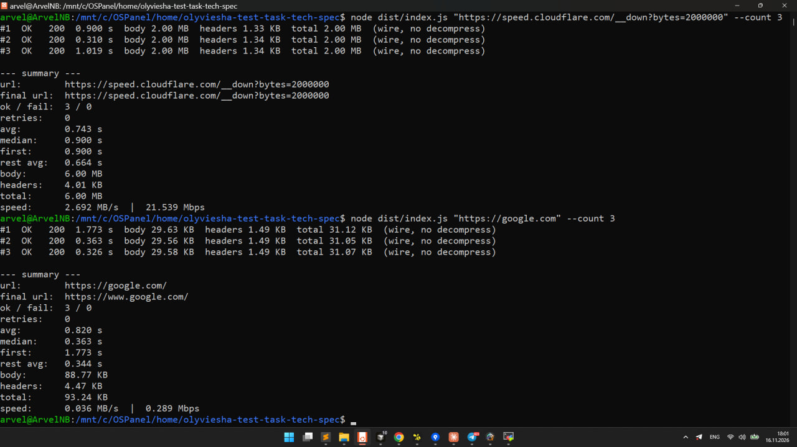
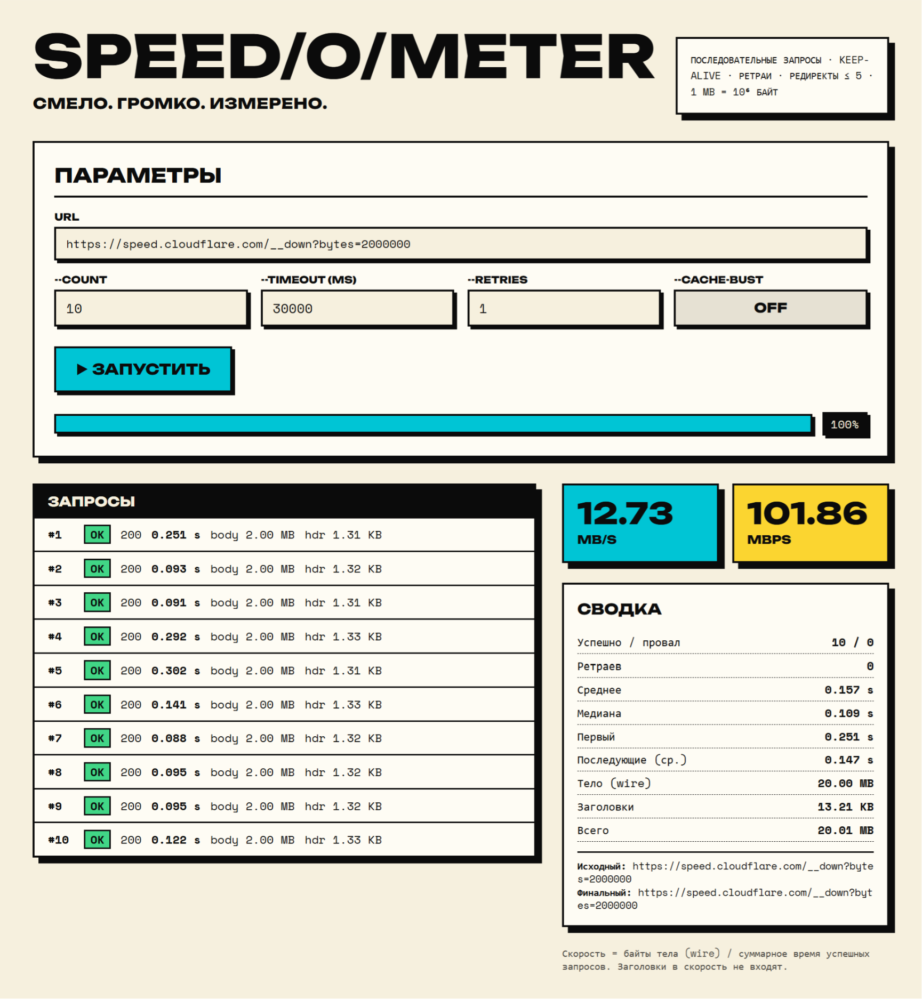
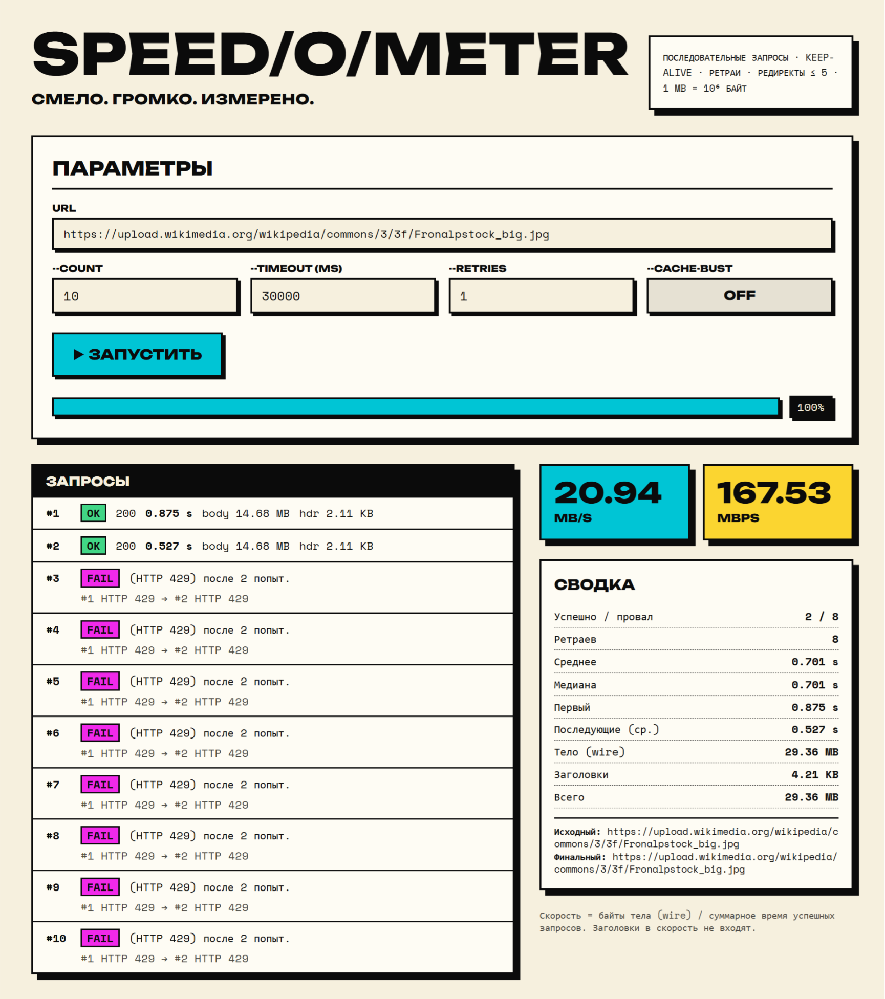

# Speedometer - замер скорости загрузки (CLI и веб)

Часть [портфолио приложений](../README.md).

Скрипт гоняет заданный URL несколько раз подряд, каждый раз дочитывает ответ до конца и печатает, сколько это заняло и сколько байт пришло. В конце — среднее, медиана и скорость.

Клиентский UI лежит отдельно в `client/`. Там та же идея, но через `fetch` в Node-сервере приложения. Браузер не видит сырые байты до gzip/br и полный набор заголовков, так что цифры в UI приблизительные. Здесь счёт идёт по тому, что реально пришло по проводу.

Нужен Node 20 или новее.

```
npm ci
npm run build
node dist/index.js https://example.com/file.bin
```

Для разработки, без сборки: `npx tsx src/index.ts <url>`.

## Примеры

Два мегабайта с Cloudflare (удобно проверить, что цифры живые):

```
node dist/index.js "https://speed.cloudflare.com/__down?bytes=2000000" --count 3
```

Тяжёлая картинка с Wikimedia — если не режут по 403/429:

```
node dist/index.js https://upload.wikimedia.org/wikipedia/commons/3/3f/Fronalpstock_big.jpg
```

Покороче серия, с cache-busting, чтобы CDN не отдавал один и тот же закэшированный ответ:

```
node dist/index.js https://example.com/image.jpg --count 5 --cache-bust
```

Жёсткий таймаут и без ретраев:

```
node dist/index.js https://example.com/slow --timeout 5000 --retries 0
```

`--help` печатает флаги.

## Как считаются единицы

1 MB здесь — это 10⁶ байт, не 2²⁰. Mbps — мегабиты в секунду, тоже по 10⁶.

Скорость = сумма байт **тела** успешных запросов / сумма их времени. Заголовки в скорость не входят, их печатаем отдельно (тело / заголовки / всего). Тело — wire, то есть как пришло по сети, до распаковки gzip/br. Размер заголовков собираем из status line + пар заголовок:значение + CRLF; undici отдаёт имена в нижнем регистре, на пару байт это может расходиться с тем, что реально ушло по TCP.

Если `Content-Length` нет (chunked) — считаем по фактически прочитанным чанкам стрима.

## Поведение

Запросы идут строго по очереди. Один keep-alive сокет на весь прогон: первый запрос обычно холоднее, в сводке он отдельно, среднее по остальным — тоже.

На сбой (сеть, таймаут, 5xx, 429) запрос повторяется `--retries` раз. Остальные 4xx сразу помечаются как fail и не ретраятся. Упавшие запросы в среднее время и объём не входят, но в сводке видны: сколько ок, сколько нет, сколько было ретраев. Если не выжил ни один — сообщение и код 1.

Редиректы 3xx — до пяти переходов. В сводке исходный URL и финальный. `--cache-bust` вешает `cb=<timestamp>-<i>` на исходный адрес, параметр уезжает дальше с редиректом.

`--timeout` режет весь запрос целиком: коннект, первый байт, чтение тела. После abort попытка считается сбоем и идёт в ретраи.

## Тесты

```
npm test
```

Тесты на подсчёт сводки (медиана, первый «холодный» запрос, упавшие запросы, скорость в единицах по 10⁶, деление на ноль) лежат в `test/` и идут на встроенном `node:test` без зависимостей. Нужен Node 22.18+: он запускает TypeScript без сборки.

## Коды выхода

- `0` — хотя бы один запрос прошёл
- `1` — все провалились
- `2` — кривые аргументы (нет URL, не парсится, отрицательный `--count` и т.п.)

## Как это выглядит

CLI — Cloudflare 2 MB и редирект google.com → www:



UI, серия из десяти запросов:



Wikimedia иногда отвечает 429, первые два успели, остальные нет — скорость считается только по живым:


