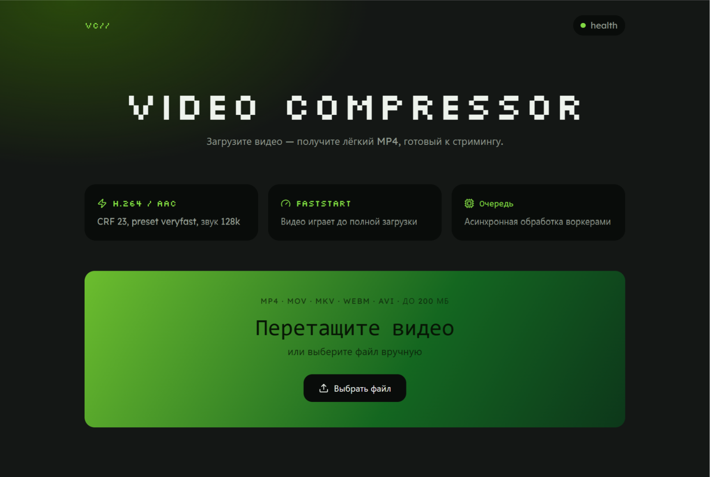
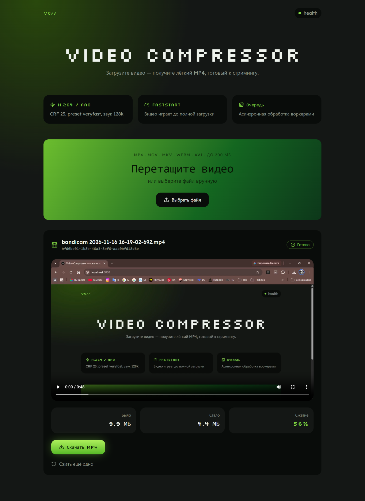

# Video Compressor - микросервис сжатия видео

Микросервис асинхронного сжатия видео: принимает файл, ставит задачу в очередь, сжимает FFmpeg'ом в H.264/AAC MP4 с `faststart` и отдаёт результат. Бэкенд на Go (только стандартная библиотека), демо-клиент на React, всё за nginx и поднимается одной командой.

Часть [портфолио приложений](../README.md).

```
browser ──▶ nginx :8080 ──┬─ /           React SPA (статика)
                          ├─ /api/*  ──▶ Go :8080 ── очередь ── воркеры ── ffmpeg
                          └─ /files/* ─▶ volume /data (готовые mp4, напрямую с диска)
```

## Демо

Загрузка и готовый результат. В карточке — исходник 9.9 МБ, после сжатия 4.4 МБ (−56%), плеер с перемоткой и кнопка скачивания.

<p align="center">
  
</p>

<p align="center">
  
</p>

<p align="center">
  <a href="docs/demo-video.mp4"><strong>▶ Смотреть прохождение</strong></a>
  — загрузка, очередь, превью и скачивание MP4
</p>

<video src="docs/demo-video.mp4" controls width="860" poster="docs/screen1.png">
  <a href="docs/demo-video.mp4">demo-video.mp4</a>
</video>

## Содержание

- [Запуск](#запуск)
- [API](#api)
- [Как это устроено](#как-это-устроено)
- [Конфигурация](#конфигурация-env)
- [Структура](#структура)
- [Тесты](#тесты)
- [Локальная разработка клиента](#локальная-разработка-клиента)
- [Осознанные упрощения](#осознанные-упрощения)

## Запуск

Нужны Docker и Docker Compose (v2).

```sh
make up        # соберёт образы и поднимет стек → http://localhost:8080
make smoke     # e2e-проверка через curl (health, 415, загрузка → completed → скачивание, faststart, Range)
make logs      # JSON-логи бэкенда
make down
```

Без `make`: `cp .env.example .env && docker compose up --build -d`.
Порт меняется в `.env` (`HTTP_PORT`). На Windows `make` работает из Git Bash/WSL.

## API

| Метод | Путь | Описание | Коды |
|---|---|---|---|
| POST | `/api/jobs` | загрузить видео (`multipart/form-data`, поле `file`) | 202, 400, 413, 415, 429 |
| GET | `/api/jobs/{id}` | статус задачи | 200, 404 |
| GET | `/api/jobs/{id}/download` | 302 на `/files/processed/{id}.mp4` | 302, 404, 409 |
| GET | `/api/health` | healthcheck (+ наличие ffmpeg, длина очереди) | 200, 503 |

```sh
curl -F file=@video.mov http://localhost:8080/api/jobs
# {"id":"6f1c…","status":"queued"}

curl http://localhost:8080/api/jobs/6f1c…
# {"id":"6f1c…","status":"completed","original_name":"video.mov","size_in":104857600,
#  "size_out":20971520,"download_url":"/files/processed/6f1c….mp4","error":null,
#  "created_at":"…","finished_at":"…"}
```

Статусы: `queued → processing → completed | failed`. Для незавершённых задач `download_url`, `size_out`, `finished_at` — `null`.
Ошибки в едином формате: `{"error":"message","code":"MACHINE_CODE"}` — коды `BAD_REQUEST`, `FILE_TOO_LARGE`, `UNSUPPORTED_MEDIA_TYPE`, `QUEUE_FULL`, `NOT_FOUND`, `JOB_NOT_READY`, `JOB_FAILED`, `SHUTTING_DOWN`, `INTERNAL`. Даже 413 от самого nginx отдаётся в этом формате.

## Как это устроено

**Загрузка.** Тело читается через `r.MultipartReader()` и `io.Copy` пишется прямо в `uploaded/{job_id}.{ext}` — ни в памяти, ни во временных файлах `ParseMultipartForm` оно не копится. В nginx `proxy_request_buffering off`, поэтому байты идут в Go по мере загрузки, а не после того, как nginx сохранит всё у себя.

**Валидация.** Расширение из белого списка (`mp4 mov mkv webm avi`) **и** сигнатура первых байт того же семейства контейнеров (ISO BMFF для mp4/mov, EBML для mkv/webm, `RIFF…AVI ` для avi). Переименованный PNG или случайные байты с `.mp4` получают 415.

**Лимит размера — тремя уровнями:** проверка `Content-Length` до чтения тела (клиент сразу получает 413, а не после 200 МБ), `http.MaxBytesReader` на всё тело и точный лимит на сам файл; плюс `client_max_body_size` в nginx. В nginx стоит `201m`: ~1 МБ запаса на заголовки multipart, чтобы файл ровно 200 МБ отклонял не nginx, а Go с точным сообщением.

**Очередь и воркеры.** `chan *Job` с буфером `QUEUE_SIZE` и пул из `WORKERS` горутин — параллельно работает не больше `WORKERS` процессов ffmpeg, остальные ждут в очереди. Постановка в очередь неблокирующая (`select … default`): при переполнении 429. Вместимость проверяется ещё до приёма тела, чтобы не гонять 200 МБ зря.

**FFmpeg.** Вызывается через `exec.CommandContext` с таймаутом `FFMPEG_TIMEOUT`, аргументы передаются слайсом (без shell и конкатенации). Конвертер спрятан за интерфейсом `Converter` — в тестах подменяется. Хвост stderr (последние 4 КБ, ограниченный буфер) пишется в лог, последняя строка уходит клиенту в `error`. Результат пишется в `{id}.mp4.part` и атомарно переименовывается, так что nginx никогда не отдаёт недописанный файл. К команде из ТЗ добавлены `-pix_fmt yuv420p` и выравнивание размеров до чётных: без этого 10-битные исходники и видео нечётного размера дают файл, который браузер не играет или x264 не кодирует.

**Безопасность путей.** Имя файла от клиента используется только для отображения (`original_name`, очищенное от путей и управляющих символов). На диске — только серверный UUID и расширение из белого списка. nginx отдаёт из `/files/` лишь `processed/<uuid>.mp4`: исходники, `.part` и листинги каталогов недоступны (404).

**Скачивание.** `GET /api/jobs/{id}/download` отвечает 302, файл отдаёт nginx напрямую с общего volume (sendfile, Range-запросы для перемотки) — Go байты не трогает.

**Очистка.** Раз в `CLEANUP_INTERVAL` удаляются завершённые задачи старше `FILE_TTL` вместе с результатами, а также «сироты»: `processed/*` без задачи (например, после рестарта) и `uploaded/*` без активной задачи. Загрузка, которая идёт прямо сейчас, не страдает: у неё свежий mtime.

**Graceful shutdown.** `signal.NotifyContext` → `http.Server.Shutdown` (новые соединения не принимаются, текущие загрузки дописываются) → пул перестаёт брать задачи и ждёт текущие конвертации в пределах `SHUTDOWN_TIMEOUT`; если не успели — ffmpeg отменяется через контекст. Задачи, которые так и не стартовали, помечаются `failed`, их исходники удаляются. В compose `stop_grace_period: 40s` больше этого таймаута.

**Наблюдаемость.** `slog` в JSON, у каждой строки есть `request_id` (берётся из `X-Request-ID`, который проставляет nginx, или генерируется; возвращается в ответе), у событий задачи — `job_id`. Healthcheck в Dockerfile; nginx стартует только после того, как бэкенд стал healthy.

**CORS не нужен:** SPA, API и файлы живут на одном origin за nginx, поэтому поверхность атаки меньше.

## Конфигурация (env)

| Переменная | По умолчанию | Описание |
|---|---|---|
| `HTTP_PORT` | `8080` | внешний порт nginx (только compose) |
| `PORT` | `8080` | порт Go |
| `WORKERS` | `2` | число параллельных ffmpeg |
| `QUEUE_SIZE` | `100` | буфер очереди |
| `MAX_UPLOAD_MB` | `200` | лимит файла |
| `FFMPEG_TIMEOUT` | `10m` | таймаут на задачу |
| `FILE_TTL` | `1h` | время жизни результата и записи о задаче |
| `CLEANUP_INTERVAL` | `10m` | период очистки |
| `SHUTDOWN_TIMEOUT` | `30s` | ожидание текущих задач при остановке |
| `DATA_DIR` | `/data` | корень volume |
| `CRF` | `23` | качество x264 (0–51) |
| `PRESET` | `veryfast` | пресет x264 |
| `FFMPEG_BIN` | `ffmpeg` | путь к бинарнику |
| `LOG_LEVEL` | `info` | `info` / `debug` |

Некорректные значения не подменяются молча: сервис не стартует и перечисляет все ошибки разом.

## Структура

```
backend/
  cmd/server/main.go       сборка зависимостей, HTTP-сервер, graceful shutdown
  internal/config/         env → Config с валидацией
  internal/storage/        раскладка volume, белый список расширений, sniff сигнатур
  internal/ffmpeg/         Converter + Runner (exec.CommandContext, таймаут, хвост stderr)
  internal/jobs/           модель, менеджер: очередь, воркеры, TTL-очистка, shutdown
  internal/api/            роутер (net/http, Go 1.22 patterns), handlers, middleware
  testdata/sample.mov      2 с MJPEG+PCM для интеграционного теста (make testdata)
  Dockerfile               golang:1.22-alpine → alpine + ffmpeg, non-root
client/                    React SPA (TanStack Start в SPA-режиме, Tailwind)
  Dockerfile               bun build → nginx:1.27-alpine со статикой
nginx/nginx.conf           SPA, /api → Go, /files → volume
docs/                      скриншоты и демо-видео для README
scripts/smoke.sh           e2e-проверка поднятого стека
docker-compose.yml, Makefile, .env.example
```

## Тесты

```sh
make lint test   # go vet + go test (без локального Go — в контейнере golang:1.22-alpine)
```

- **config** — дефолты, переопределения, сбор всех ошибок.
- **storage** — нормализация расширений (включая `../../etc/passwd`, `evil.mp4.exe`), сигнатуры (PNG/WAV/текст под видом видео).
- **ffmpeg** — аргументы передаются слайсом, ограниченный буфер stderr, kill по таймауту и отмене; с реальным ffmpeg — конвертация с проверкой faststart и ошибка на битом файле.
- **jobs** — `queued → processing → completed`, `failed` с удалением исходника, при `WORKERS=2` и 5 задачах одновременно работают ровно 2, переполнение очереди, TTL-очистка с фиктивными часами, shutdown (ждёт текущую, валит очередь, отменяет по таймауту).
- **api** — `httptest` на весь жизненный цикл, 400/404/409/413/415/429, формат JSON, предварительная проверка `Content-Length`; интеграционный тест прогоняет `testdata/sample.mov` через настоящий ffmpeg.

Тесты с ffmpeg пропускаются, если его нет в системе.

## Локальная разработка клиента

```sh
make up                    # бэкенд и nginx на :8080
cd client && bun install && bun run dev
```

Dev-сервер Vite проксирует `/api` и `/files` на `http://localhost:8080` (переопределяется через `BACKEND_URL`). Клиент собирается TanStack Start в SPA-режиме (`spa.enabled`): на выходе статика и HTML-оболочка, которые отдаёт nginx, без Node в рантайме.

## Осознанные упрощения

- **Состояние в памяти.** Без БД и S3/MinIO: после рестарта задачи теряются, а файлы-сироты подчистит очистка. Для демо это нормально; в проде — Postgres/Redis для статусов и объектное хранилище.
- **Один инстанс.** Очередь — канал внутри процесса. Горизонтальное масштабирование потребует внешнего брокера (Redis Streams, NATS, SQS).
- **Next steps:** аутентификация, rate limiting по IP (`limit_req` в nginx), прогресс ffmpeg в реальном времени (`-progress pipe:1` → SSE), выбор формата и качества, HLS/DASH, метрики Prometheus.
