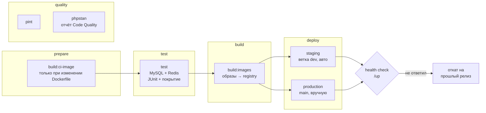

# CI/CD для Laravel API на GitLab

Пайплайн из коммерческого проекта (Laravel, PHP 8.4, MySQL, Redis, Horizon, Docker Compose) в переработанном и обезличенном виде: адреса серверов, домены и названия заменены переменными.

[← Примеры кода](../../README.md)



## Что делает

| Этап | Джобы | Детали |
| --- | --- | --- |
| prepare | `build:ci-image` | PHP-образ с gd, intl, redis, pcov и composer собирается один раз и лежит в registry; запускается, только если поменялся `ci/php.Dockerfile` |
| quality | `pint`, `phpstan` | Стиль и статический анализ на каждый MR; ошибки PHPStan видны прямо в MR через отчёт Code Quality |
| test | `test` | Миграции и сиды на живых MySQL и Redis, весь набор тестов без остановки на первой ошибке, отчёт JUnit и покрытие в MR |
| build | `build:images` | Образы `app`, `nginx`, `smtp-proxy` с тегом коммита пушатся в GitLab Container Registry |
| deploy | `deploy:staging`, `deploy:production` | По SSH: `compose pull` → `up -d` → миграции → `optimize` → перезапуск Horizon. Затем проверка `/up`; если приложение не ответило — автоматический откат на предыдущий тег |

## Решения

| Было в исходном пайплайне | Стало | Зачем |
| --- | --- | --- |
| IP серверов, домены и путь на сервере прямо в YAML | CI/CD Variables со scope на окружение | В репозитории нет инфраструктуры; staging и production отличаются только переменными |
| Деплой под `root` | Отдельный deploy-пользователь, ключ — переменная типа File | Минимум прав для CI |
| `ssh-keyscan` при каждом деплое | Отпечатки серверов в `SSH_KNOWN_HOSTS` | Без слепого доверия ключу хоста (защита от MITM) |
| Расширения PHP ставятся в `before_script` каждого джоба | Готовый CI-образ | Минус несколько минут на каждый джоб |
| `rsync` исходников и `docker compose build` на сервере | Образы собираются в CI и пушатся в registry, сервер только делает pull | Прод не тратит ресурсы на сборку, на всех окружениях одинаковые артефакты, откат — это предыдущий тег |
| `interruptible: true` наследовался деплоем | Для деплоя `interruptible: false` + `resource_group` | Новый коммит не оборвёт выкладку на середине, два деплоя в одно окружение не пересекутся |
| Проверки на `dev` ручные и необязательные | `pint`, `phpstan` и тесты автоматически на MR, `main` и `dev` | Ошибки ловятся до мержа, а не после |
| Дубли пайплайнов для ветки с MR | Правило `workflow` отсекает push-пайплайн, если MR открыт | Раннеры не делают одну работу дважды |
| Ожидание MySQL молча заканчивалось через 60 секунд | Явная ошибка, если база не поднялась | Падение по понятной причине, а не на миграциях |
| Нет проверки после деплоя | Health check `/up` и автоматический откат | Сломанный релиз не остаётся на окружении |

## Переменные GitLab

| Переменная | Тип | Где |
| --- | --- | --- |
| `SSH_PRIVATE_KEY` | File, protected | staging, production |
| `SSH_KNOWN_HOSTS` | Variable | staging, production |
| `DEPLOY_HOST`, `DEPLOY_USER`, `DEPLOY_PATH` | Variable | staging, production |
| `APP_URL` | Variable | staging, production |
| Deploy token `gitlab-deploy-token` | `read_registry` | проект (GitLab передаёт его как `CI_DEPLOY_USER` / `CI_DEPLOY_PASSWORD`) |

`docker-compose.prod.yml` проекта задаёт для сервисов и `build`, и `image: ${CI_REGISTRY_IMAGE}/<service>:${IMAGE_TAG}`: в CI по нему собираются образы, на сервере — подтягиваются.

## Файлы

```
.gitlab-ci.yml       пайплайн
ci/php.Dockerfile    образ для PHP-джобов CI
ci/deploy.sh         деплой и откат на сервере (MODE=deploy | rollback)
```
